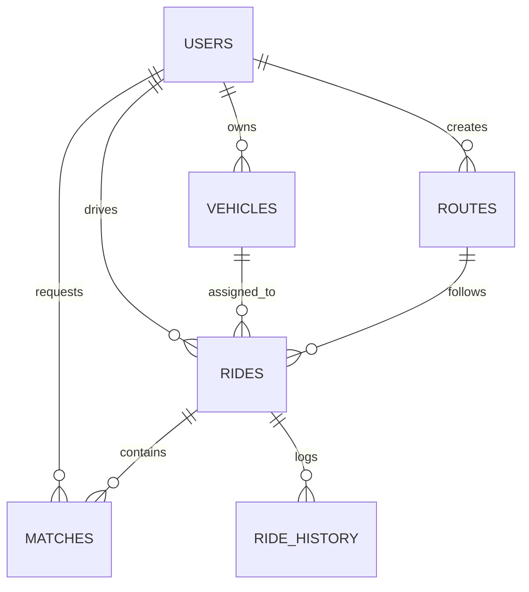

# SmartCommute — Intelligent Commuter Transit & Navigation Platform

[](https://www.python.org/downloads/)
[](https://flask.palletsprojects.com/)
[](https://www.postgresql.org/)
[](https://leafletjs.com/)
[](https://opensource.org/licenses/MIT)

> **SmartCommute** is an enterprise-grade, commuter-sharing transit and corridor-navigation web platform built with Apple Human Interface design principles and backed by a relational PostgreSQL database.

---

## Key Highlights

- **Orbital Constellation Hero Stage:** Dark-mode cinematic hero featuring an orbital nighttime perspective of global city networks.
- **High-Resolution Satellite Maps:** Default Esri World Imagery satellite view with turn-by-turn route geometry and an interactive Satellite / Street layer switcher.
- **Google Maps-Grade Worldwide Autocomplete:** Powered by Komoot Photon OSM Geocoder and OpenStreetMap Nominatim, indexing buildings, campuses, shops, hospitals, landmarks, and addresses globally.
- **Dijkstra Shortest-Path Matching:** Min-heap Dijkstra heuristics calculate optimal corridor overlap, fuel-sharing contributions, and travel ETAs.
- **Synchronized Multi-Modal Fallbacks:** Intelligently provides synchronized local transit alternatives when direct rides are unavailable.
- **Real-Time GPS Telemetry HUD:** Interactive driving telemetry HUD showing live vehicle tracking, speed, remaining distance, and step guidance.
- **Executive Operations Suite:** Administrative command center with telemetry analytics, SQL benchmark execution timers, commuter verification, and dispatch controls.

---

## Pre-Built Demo Accounts & Credentials

SmartCommute comes pre-seeded with verified test accounts for immediate testing:

| Role | Name | Email | Password | Features |
| :--- | :--- | :--- | :--- | :--- |
| **Admin** | Executive Administrator | `admin@sc.in` | `SmartAdmin@2026` | SQL Diagnostics, Dispatch, Commuter Verification, Audit Logs |
| **Driver / Pilot** | Aarav Patil | `aarav.patil@college.edu` | `DemoPass@123` | Tata Nexon EV (`MH-09-AB-1234`), Open Route toward KIT College |
| **Driver** | Rohan Kulkarni | `rohan.kulkarni@college.edu` | `DemoPass@123` | Honda CB Hornet Bike (`MH-09-XY-5678`), Local Rajarampuri route |
| **Commuter** | Atharv Jadhav | `atharv.jadhav@college.edu` | `DemoPass@123` | Hyundai Creta (`MH-09-AJ-7777`), CBS Transit Corridor |
| **Commuter** | Isha Deshmukh | `isha.deshmukh@college.edu` | `DemoPass@123` | Verified Student Passenger |
| **Commuter** | Harshad Desai | `harshad.desai@college.edu` | `DemoPass@123` | Maruti Swift (`MH-09-EF-3456`) |

> **Note:** For quick testing in the Sign-In modal, use the **Instant 1-Click Commuter Login** preset buttons to sign in with zero typing. Demo commuters also accept `password123` as a fallback.

---

## Architecture & Relational Schema

SmartCommute runs on a normalized 6-table relational PostgreSQL schema (`smartcommute_db`):



1. **`users`**: Commuter profiles, hashed passwords, verification flags, and account roles (`commuter` / `admin`).
2. **`vehicles`**: Registered cars, bikes, and scooters with capacities and license plates.
3. **`routes`**: Origin, destination, and intermediate corridor waypoints.
4. **`rides`**: Scheduled departures, seat allocations, dynamic fuel-cost splits, and statuses (`open`, `full`, `in_progress`, `completed`, `cancelled`).
5. **`matches`**: Passenger seat reservations, boarding/dropoff points, and statuses (`pending`, `accepted`, `rejected`).
6. **`ride_history`**: Immutable lifecycle audit logging with timestamps.

---

## Local Setup & Quickstart

### 1. Prerequisites
- **Python 3.10+**
- **PostgreSQL 14+** (with pgAdmin 4 recommended)
- **Git**

### 2. Clone the Repository
```bash
git clone https://github.com/<your-username>/SmartCommute.git
cd SmartCommute
```

### 3. Setup Virtual Environment
```bash
# Windows
python -m venv .venv
.venv\Scripts\activate

# macOS / Linux
python3 -m venv .venv
source .venv/bin/activate
```

### 4. Install Dependencies
```bash
pip install -r requirements.txt
```

### 5. Configure Environment Variables
Copy `.env.example` to `.env`:
```bash
cp .env.example .env
```
Edit `.env` with your PostgreSQL credentials:
```ini
DB_HOST=localhost
DB_PORT=5432
DB_NAME=smartcommute_db
DB_USER=postgres
DB_PASSWORD=your_postgres_password
SECRET_KEY=smartcommute_secure_random_key_2026
```

### 6. Initialize Database & Seed
SmartCommute automatically verifies and initializes the PostgreSQL schema and seeds test data upon application boot:
```bash
python -c "from database import setup_all; setup_all()"
```

### 7. Run the Server
```bash
python app.py
```
Open [http://127.0.0.1:5000](http://127.0.0.1:5000) in your browser.

---

## Steps to Deploy on GitHub

Follow these steps to push this project to your GitHub repository:

### 1. Verify Git Status
```bash
git status
```
Ensure `.env` is **NOT** tracked (it is included in `.gitignore`).

### 2. Initialize and Stage Files
```bash
git init
git add .
```

### 3. Create Initial Commit
```bash
git commit -m "feat: flagship SmartCommute platform with satellite maps and global geocoding"
```

### 4. Link Remote Repository & Push
Create a new empty repository on [GitHub](https://github.com/new) named `SmartCommute`. Then run:
```bash
git branch -M main
git remote add origin https://github.com/<your-username>/SmartCommute.git
git push -u origin main
```

---

## Production Cloud Deployment (Render / Railway / Heroku)

SmartCommute includes `gunicorn` in `requirements.txt` for production WSGI serving.

### Deploying to Render
1. Create a new **Web Service** on [Render](https://render.com).
2. Connect your GitHub repository.
3. Configure the build and start commands:
   - **Build Command:** `pip install -r requirements.txt`
   - **Start Command:** `gunicorn app:app`
4. In **Environment Variables**, provide your managed PostgreSQL connection parameters (`DATABASE_URL`, `SECRET_KEY`, etc.).

---

## License
Distributed under the MIT License. See `LICENSE` for details.
